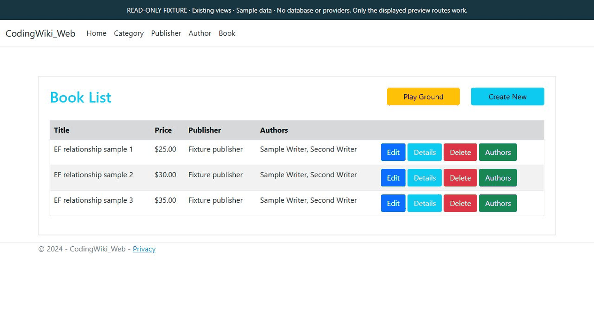

# CodingWiki EF

Educational Entity Framework Core examples built around books, authors, publishers and related entities, with console exercises and an ASP.NET Core MVC application.

## Captured preview

<picture><source media="(prefers-reduced-motion: reduce)" srcset="docs/screenshots/portfolio-poster.png" /><source type="image/webp" srcset="docs/screenshots/portfolio.webp" /></picture>

Existing book, book-detail and author views with sample relationships. No EF query, save or database operation.

[Reproduce this capture and view the static image](docs/PORTFOLIO-PREVIEW.md)

## Implementation highlights

- Entity relationships, composite mapping entities and sample data definitions.
- Data annotations and separate Fluent API configuration classes.
- Migrations and a keyless entity mapped to a database view.
- MVC CRUD controllers and commented console examples for exploring EF behavior.

## Repository map

| Path | Purpose |
|---|---|
| [CodingWiki_Model](CodingWiki_Model) | Entities and alternate Fluent API models |
| [CodingWiki_DataAccess](CodingWiki_DataAccess) | Context, FluentConfig and migrations |
| [CodingWiki_Console](CodingWiki_Console) | Console learning exercises |
| [CodingWiki_Web](CodingWiki_Web) | MVC host, controllers and views |

## Requirements and configuration

Use an SDK capable of targeting .NET 10 and an isolated SQL Server development database. Package restore requires access to the configured NuGet feeds. The projects target .NET 10 LTS. Install the latest supported .NET 10 SDK and runtime patch.

The MVC host reads `ConnectionStrings:DefaultConnection`. Set `ConnectionStrings__DefaultConnection` in your own shell or local secret configuration; do not copy a machine-specific connection target into shared settings.

Review [ApplicationDbContext.cs](CodingWiki_DataAccess/Data/ApplicationDbContext.cs) and [Migrations](CodingWiki_DataAccess/Migrations) before preparing an isolated schema. Some exercises require the view mapped by `MainBookDetails`, not only the base tables. The commented OnConfiguring example is not an active runtime override.

## Build and run

```powershell
git clone https://github.com/s-hesam-s/CodingWiki_EF.git
cd CodingWiki_EF
```

```powershell
dotnet restore CodingWiki.sln
dotnet build CodingWiki.sln --no-restore
```

After database preparation and configuration:

```powershell
dotnet run --project CodingWiki_Web/CodingWiki_Web.csproj --launch-profile https
```

Open `https://localhost:7242`, the checked-in HTTPS address. The MVC controllers cover books, authors, categories and publishers.

The console entry point can be inspected independently:

```powershell
dotnet run --project CodingWiki_Console/CodingWiki_Console.csproj
```

Most console database exercises are commented out; running the console does not automatically execute the full set of EF examples. Inspect the selected exercise and its database effects before enabling it.

## Verification

There is no automated test suite in this repository. Build first, then verify the selected MVC or console exercise against an isolated database. Schema creation and data changes are separate steps, not performed by the build command.

## Project scope and reuse

This is an educational repository. The implementation notes describe the code in this repository; they do not claim a deployed commercial service or measured production results. Third-party libraries and assets retain their own terms. No project-wide license is currently declared.

## Continuous integration

GitHub Actions restores and builds `CodingWiki.sln` in Release mode on Windows using the .NET 10 target. No automated application test suite exists in this repository, so the workflow does not claim application-test coverage. The application hosts, database migrations/seeds, cloud integrations and payments are not started by CI.

The [CI workflow](.github/workflows/ci.yml) runs for pull requests and pushes to `master`, and can be started manually. It uses read-only repository permissions and does not deploy the project.

## Runtime maintenance

See [runtime, dependency audit and migration notes](docs/RUNTIME.md) for the .NET 10 target and verification boundaries.

[Local verification snapshot](docs/VERIFICATION.md) records the build, isolated-test and dependency-audit boundaries.
